# 镜头包总览

共 11 个镜头。每个镜头一个文件夹：`structure.png`（结构参考图，请一并上传）+ `prompt.md`（中文/英文提示词，直接复制）。

**用法（Codex / 其它图像模型）**：上传 `structure.png` 作为图1，粘贴 `prompt.md` 里的中文或英文提示词；风格统一靠 `style-card.md`（每个提示词里已经带了）。

**先试 2~3 张**：建议先跑 `04-court-west`（庭院）、`09-hall`（室内）、`01-ext-se`（外观）看结构有没有保住，再决定要不要改提示词。

**前提假设**：二层南半区（车库和一层卧室上方）还没画房间，按“有房间”处理：外观镜头里它就是屋顶下的整面白墙，没有出室内镜头。

| # | 镜头 | 一句话 | 缩略图 |
|---|---|---|---|
| 01 | [外观·东南角](01-ext-se/prompt.md) | 一层、二层外立面全貌，从院外东南角抬眼看。 | 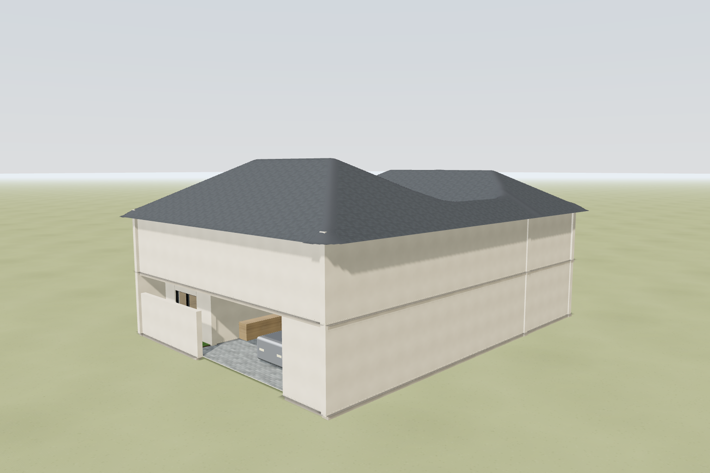 |
| 02 | [外观·正南立面](02-ext-south/prompt.md) | 正对南面的立面，车库入口居中偏左。 | 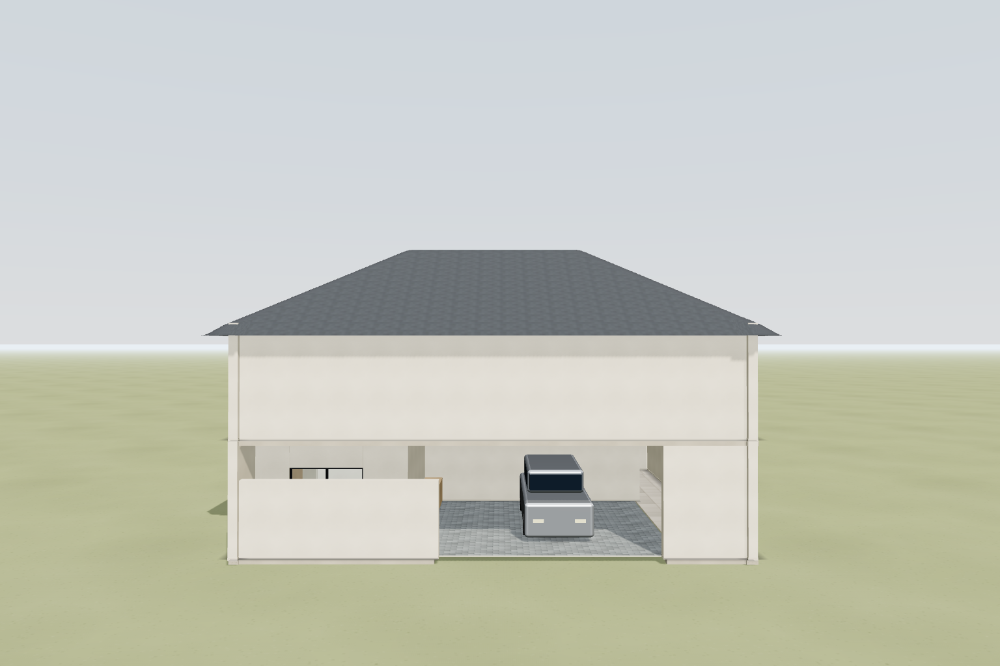 |
| 03 | [外观·鸟瞰屋顶](03-aerial/prompt.md) | 从东南上空俯瞰屋顶和中间的天井缺口。 | 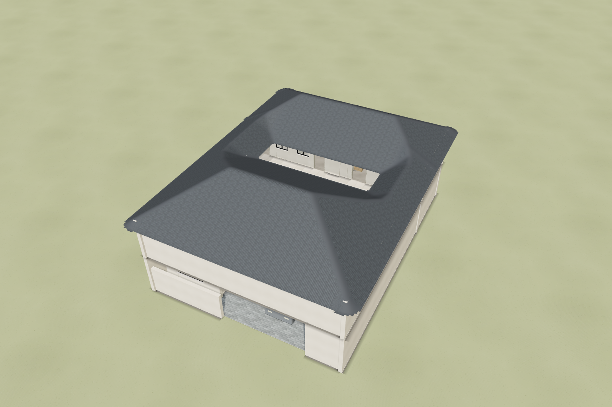 |
| 04 | [庭院·从西端看](04-court-west/prompt.md) | 站在庭院西端，沿庭院长向往东看。 | 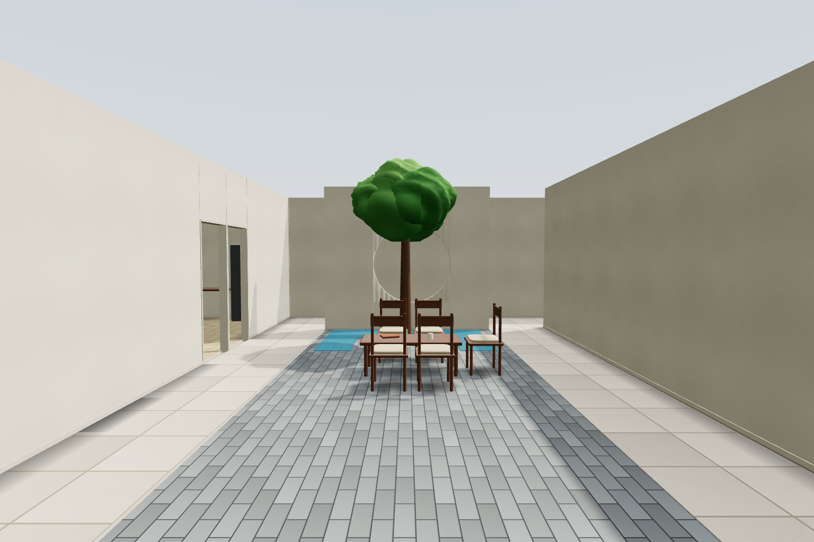 |
| 05 | [庭院·透过月洞窗](05-moon-gate/prompt.md) | 隔着一面墙上的大圆洞（月洞窗）看庭院，画面以圆洞为取景框。 | 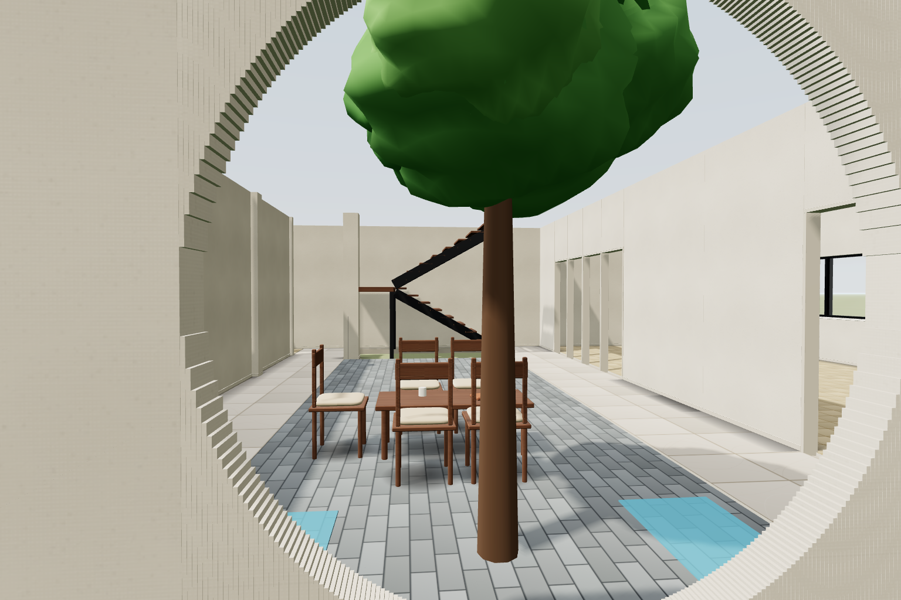 |
| 06 | [庭院·二层回廊俯看](06-court-2f/prompt.md) | 站在二层回廊边，看对面北侧两层的立面。 | 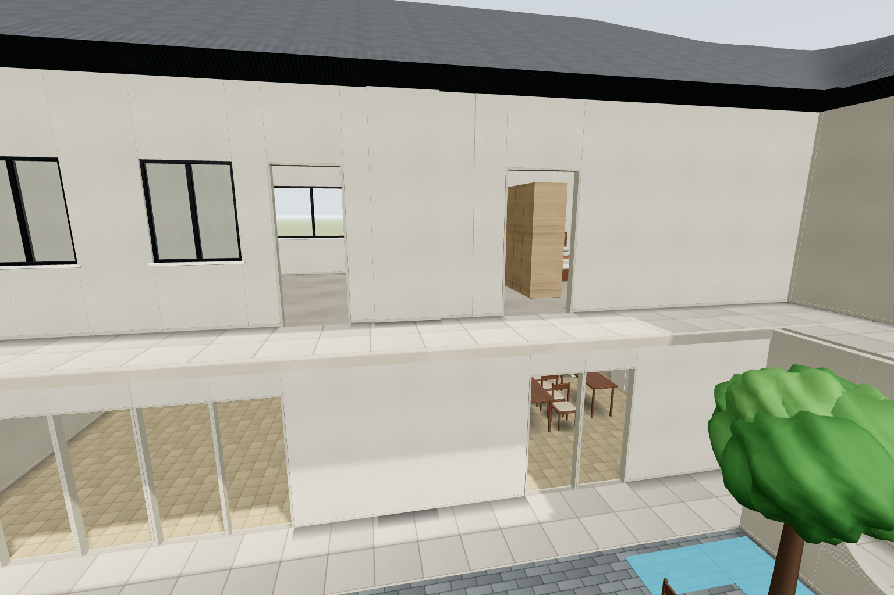 |
| 07 | [廊下·一层回廊](07-arcade/prompt.md) | 站在一层廊下，一边是室内厨房餐厅的落地玻璃，一边是庭院。 | 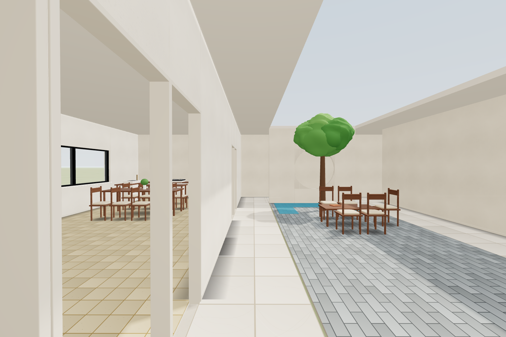 |
| 08 | [楼梯·镂空钢木双跑](08-stair/prompt.md) | 庭院里的镂空双跑楼梯，梯下空间完全通透。 | 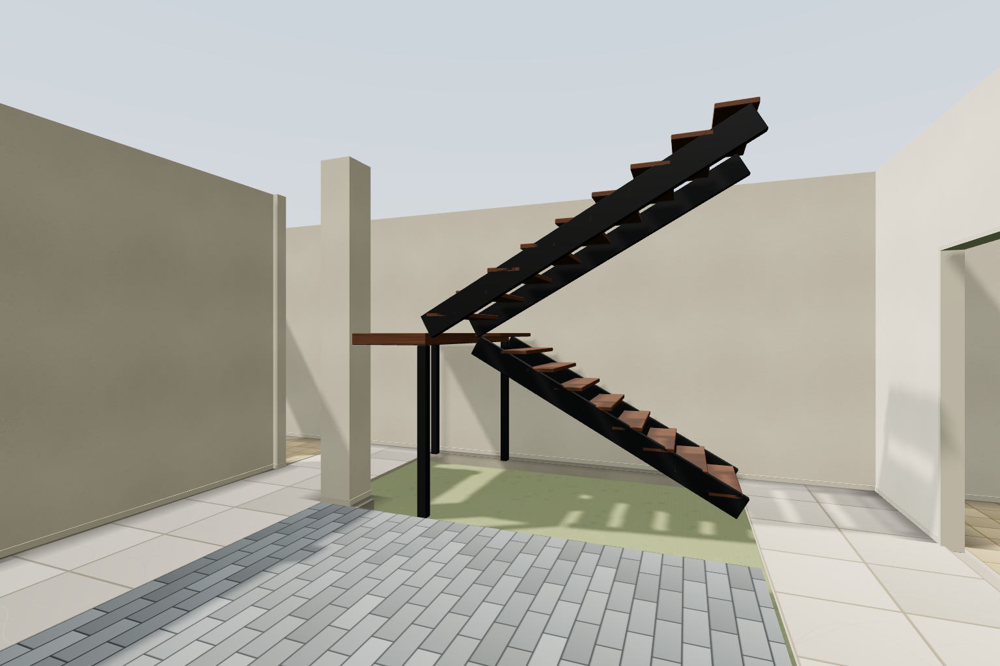 |
| 09 | [一层·厨房餐厅](09-hall/prompt.md) | 一层北面的开放式长厨房餐厅，一侧是大横窗，一侧是落地玻璃。 | 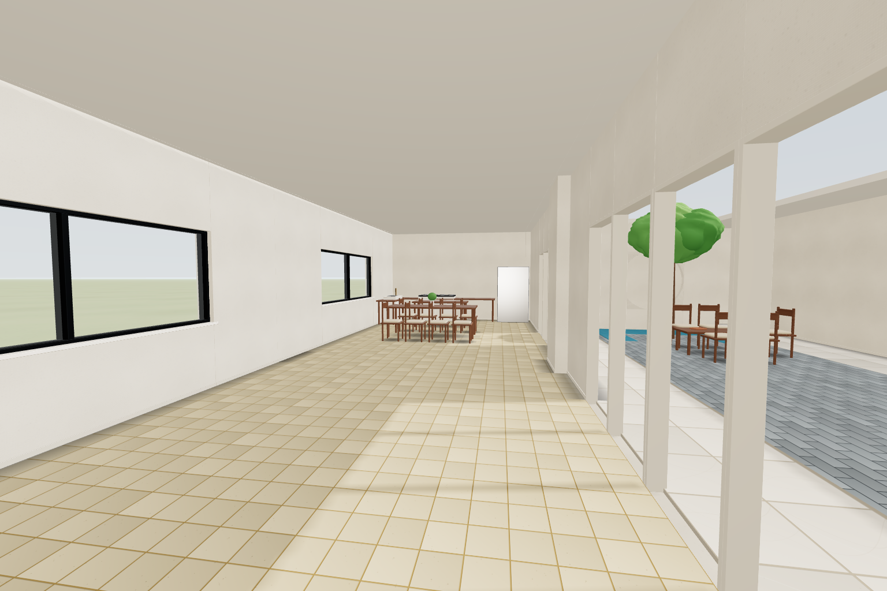 |
| 10 | [一层·卧室](10-bedroom-1f/prompt.md) | 一层南侧卧室，木地板、一张床、一扇大窗。 | 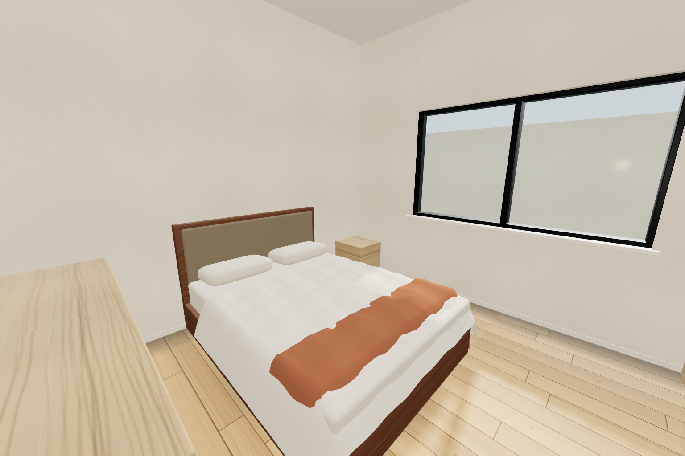 |
| 11 | [二层·主卧](11-master-2f/prompt.md) | 二层北侧主卧，两个通顶衣柜围出入口，窗朝北。 | 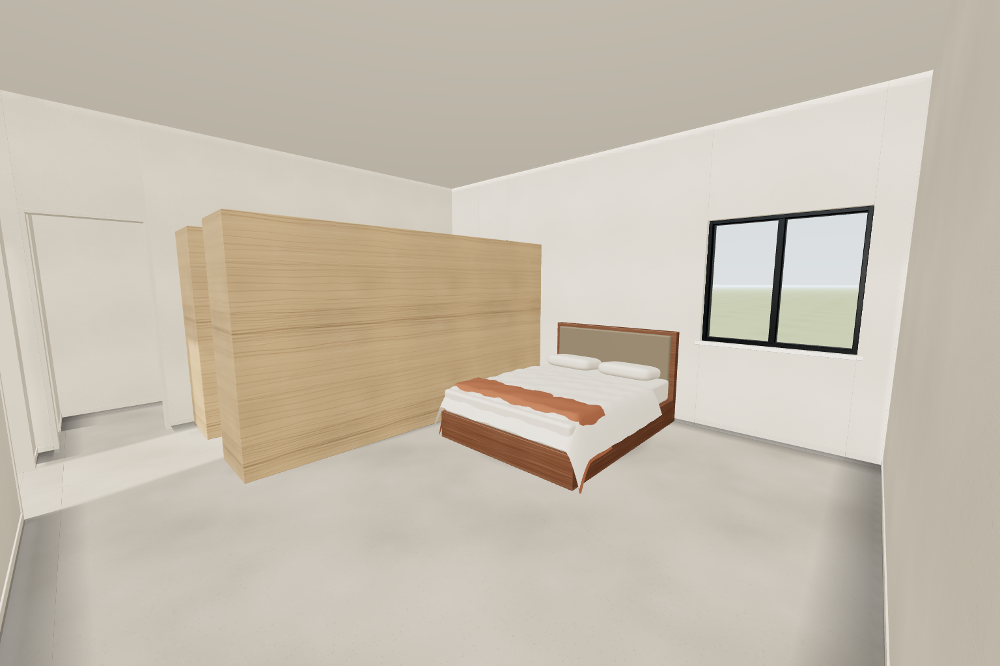 |
